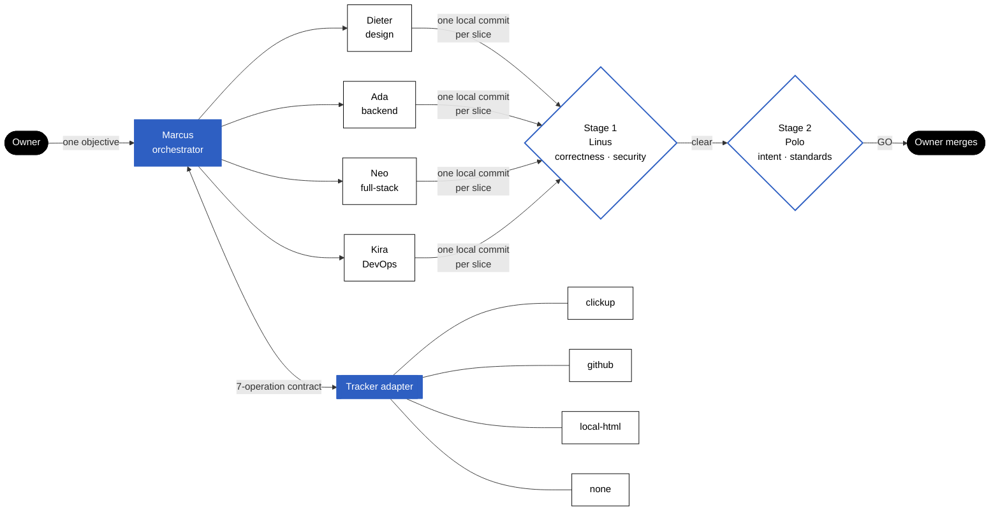

<div align="center">

# Marcus

**A delivery team of AI agents for Claude Code that plans, builds and reviews software, and never ships without a human's yes.**

<p>
  
  
  
  
  
</p>

**1** orchestrator · **6** delivery agents + **1** research analyst · **16** skills · **4** tracker backends · **2**-stage review gate

[Why](#why) · [How it works](#how-it-works) · [Agents](#the-agents) · [Skills](#the-skills) · [Trackers](#tracker-adapters) · [Safety](#safety-guardrails) · [Quick start](#quick-start) · [Status](#project-status)

</div>

---

## In plain words

You describe what you want, in one sentence. Marcus acts like a small software team: it asks clarifying questions, writes a plan, splits the work into small independent pieces, and hands each piece to a specialist (backend, frontend, design, infrastructure). Every result is checked twice, first for **correctness and security**, then for **"is this what was actually asked for?"**. Nothing is published, merged into production or sent to the outside world unless the human owner explicitly allows it.

```text
/marcus new "customers can export their order history as CSV"
```

## Why

AI coding agents are fast, but left alone they drift: they widen their scope, review their own work, and push changes nobody approved. Marcus is an **architecture for keeping agents useful and accountable**:

- **Separation of duties.** The agent that builds a change is never the one that approves it.
- **Small, isolated units of work.** Each slice gets its own git worktree (a separate working copy of the code) and a file fence it may not leave.
- **Controls sized to risk.** Reading is free; anything irreversible (push, merge, production, spending) needs the owner.
- **Memory outside the chat.** State lives in the tracker and in handoff files, so any fresh session can resume.

## How it works



Every piece of work moves through seven phases, one gate each:

```text
DISC → ARCH → DESI → DEV → QA → REV → HAND
discovery · architecture · design · build · QA · review · handoff
```

1. **Discover.** Marcus interviews the owner until the acceptance criteria are unambiguous, then writes a spec.
2. **Slice.** The spec is cut into vertical slices, each demoable on its own and **on files no other slice touches**.
3. **Build.** One agent, one worktree, one branch and one local commit per slice.
4. **Review.** Marcus checks the contract was respected, Linus reviews the code (Stage 1), Polo judges the whole wave against the owner's intent (Stage 2).
5. **Hand off.** Each ticket gets a comment with what was built and what was actually verified. The merge is the owner's call.

## The agents

**Marcus**, the orchestrator, is not a separate agent: it is a skill that the main Claude Code session adopts, because only the main session can hold state and spawn sub-agents. It directs six delivery agents:

| Agent | Role | What it owns |
|---|---|---|
| **Linus** | CTO · **Stage 1 gate** | Architecture, ADRs (short written records of design decisions), QA, code and security review. Read-only on product code. |
| **Polo** | Chief of Staff · **Stage 2 gate** | Final GO / NO-GO against the owner's standards. Reports to the owner, not to Marcus. |
| **Ada** | Backend developer | Supabase schema, migrations, row-level security, RPCs, Edge Functions, API layer. |
| **Neo** | Full-stack developer | React / Vite / TypeScript / Tailwind front end, i18n, API wiring. |
| **Dieter** | UI/UX designer | `DESIGN.md`, design tokens, prototypes, microcopy, accessibility. |
| **Kira** | DevOps engineer | Netlify, CI, environment variables, domains, security headers, provisioning wizards. |

Alongside the delivery team, **Magellan** (`agents/magellan.md`) is a research analyst spawned only by `/marcus evaluate`, to research an idea on the open web before any project exists. It gives evidence with sources, never a verdict.

> **Rule for the roster:** a role exists only against a bottleneck someone counted, and is removed when it catches nothing over three consecutive waves.

## The skills

Sixteen skills, loaded on demand so each session only pays for what it uses.

| Group | Skills |
|---|---|
| **Orchestrator** | `marcus` (core, plus 11 mode files and the tracker adapters) |
| **Delivery method** | `marcus-interview` · `marcus-spec` · `marcus-slice` · `marcus-build` · `marcus-code-review` · `marcus-qa` · `marcus-diagnose` · `marcus-checkpoint` · `marcus-wizard` |
| **Team discipline** | `marcus-workflow` · `marcus-guidelines` · `marcus-voice` |
| **Domain** | `supabase-authz` · `privacy-nlpd-gdpr` · `i18n-fr-en` |

Modes include `evaluate`, `new`, `resume`, `status`, `prototype`, `justflow` (work the open queue overnight, hand back decisions) and `ultraflow` (run to one objective, only when the owner arms it).

## Tracker adapters

Marcus never talks to a tracker directly. It speaks a **contract of seven operations** (`create` · `status` · `comment` · `query` · `link` · `milestone` · `label`) and ten fixed states. An **adapter** maps that contract onto the tool you use, so the workflow stays the same and only the adapter changes.

| Backend | Needs | Status |
|---|---|---|
| `clickup` | ClickUp MCP connector | **In service.** The one used day to day. |
| `github` | `gh` and GitHub Issues | Specified, not yet exercised. |
| `local-html` | `python3` and a browser: no account, no network | Specified, not yet exercised. |
| `none` | Nothing; handoff files carry the state | For single throwaway runs. |

A new tracker (Linear, for example) is one new adapter file. The procedures still name ClickUp calls in places, so porting to another backend is a bounded job rather than a config switch. See [`skills/marcus/trackers/README.md`](skills/marcus/trackers/README.md).

## Safety guardrails

Agents hold real tools, so the brakes are **code, not prompts**:

- **No push, PR or merge by default.** `hooks/block-dangerous-git.sh`, a `PreToolUse` hook (a check that runs before every command the agent tries), blocks them. They unlock only when an arming sentinel (a small permission file) exists, and **only the human owner creates it**.
- **Production is off-limits in every mode.** Force-push, hard reset, history rewrite, branch deletion, `supabase db push` and anything targeting the production branch stay blocked, armed or not. The production branch name is read from the project's config at hook time.
- **The owner's identity, no AI trailer.** Agents commit locally only, under the owner's git identity; `hooks/commit-msg` strips AI co-author trailers.
- **No private identifiers outward.** `hooks/block-private-identifiers.sh` checks outbound commands and web calls.
- **Risk-based gates.** Actions are classed from L1 (read) to L4 (irreversible). L4 always goes through Stage 1, Stage 2 and then the owner, never an agent.
- **The reviewer is independent.** Polo sits outside the chain of command; inside an armed run, its NO-GO blocks the merge and the orchestrator cannot overrule it.

```bash
touch .claude/.ultraflow      # owner only, never an agent
/marcus ultraflow "<verifiable objective>"
rm .claude/.ultraflow
```

## Quick start

Requires [Claude Code](https://docs.anthropic.com/en/docs/claude-code), `git` and `jq`.

```text
/plugin marketplace add JayGamb/marcus
/plugin install marcus
/marcus prototype "a pricing page with three tiers"   # no tracker, no config needed
```

When you want the full pipeline, run `/marcus init` once per repository. It asks which tracker backend to use, installs the guardrails and writes `marcus.config.json`.

To inspect it without installing:

```bash
git clone https://github.com/JayGamb/marcus.git && cd marcus
claude --plugin-dir . plugin details marcus
```

## Project status

**Experimental, v0.1.0, built and used by one person.** Marcus is a Claude Code plugin made of Markdown skills, agent definitions and shell hooks, with no runtime, service or package.

- The full pipeline and the `clickup` adapter are in regular use on the owner's own projects.
- The `github` and `local-html` adapters are written but not yet exercised.
- What has and has not been proven, mode by mode, is documented honestly in [`docs/WORKFLOW.md`](docs/WORKFLOW.md) §9.

**Start here:** [`docs/WORKFLOW.md`](docs/WORKFLOW.md) is the whole system in one document.

```text
skills/marcus/          the orchestrator: core, modes, tracker adapters, templates
skills/marcus-*/        delivery and discipline skills
skills/<domain>/        supabase-authz · privacy-nlpd-gdpr · i18n-fr-en
agents/                 linus · polo · ada · neo · dieter · kira  (+ magellan, research)
hooks/                  git guardrail · commit-msg · private-identifier guard
docs/WORKFLOW.md        the full design document
```

## Author

[@JayGamb](https://github.com/JayGamb).
Designed as an exercise in architecture for AI agents: separation of duties, explicit contracts, adapter patterns and controls sized to how hard an action is to undo.

## License

[MIT](LICENSE). The copyright holder is named in [`LICENSE`](LICENSE).
